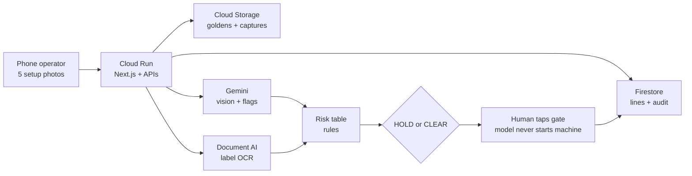

# Golden Frame

Phone-first changeover gate for the **Google Cloud AI Builder Cup** (Manufacturing — Intelligent Operations).

**Don’t start until today’s setup looks like the last good run.**

The operator shoots five frames on a phone. **Gemini** judges look-alike and flags. **Document AI** reads the printed product code on the label. A **risk table** decides **HOLD** or **CLEAR**. A human still taps the gate. The model never starts a machine.

**Live demo:** https://golden-frame-216812516383.asia-south1.run.app

---

## Why this is not a chatbot

| Piece | Who decides |
|---|---|
| Vision / look-alike | Gemini |
| Label product code (SKU) | Document AI (Gemini OCR fallback) |
| Wrong SKU / open guard / leftover material | Risk table (rules beat model prose) |
| Start / no-start | Operator or supervisor on the phone |

Same engine, two demo lines: **Line 3 Packaging (A-17)** and **Cell 2 Electronics (BRD-440)**.

---

## Google Cloud stack

| Service | Job |
|---|---|
| **Cloud Run** | Hosts Next.js app + `/api/inspect` and related APIs |
| **Cloud Storage** | Golden album + today’s capture evidence |
| **Firestore** | Custom lines + HOLD/CLEAR audit |
| **Gemini** | Multimodal vision / flags (`gemini-3.8-flash`) |
| **Document AI** | OCR on the label frame only |
| **Cloud Build** | Builds the container on deploy |

Health check: `GET /api/health` → `gemini`, `firestore`, `storage`, `documentai`.

Step-by-step GCP setup: [`docs/GCP_SETUP.md`](docs/GCP_SETUP.md).  
Architecture detail + PNG: [`docs/ARCHITECTURE.md`](docs/ARCHITECTURE.md).

### Architecture



```text
Phone → Cloud Run → Storage + Firestore
                 → Gemini (vision) + Document AI (label text)
                 → Rules → HOLD / CLEAR → human logs audit
```

---

## Setup (local)

Needs **Node 20+**.

```bash
cd google-hackathon
npm install
cp .env.example .env.local
```

Minimum `.env.local` for Live:

```
GEMINI_API_KEY=your_key
GEMINI_MODEL=gemini-3.8-flash
NEXT_PUBLIC_DEFAULT_ENGINE=live
GCP_PROJECT_ID=your-project
GCS_BUCKET=your-bucket
DOCUMENT_AI_PROCESSOR=your-processor-id
DOCUMENT_AI_LOCATION=us
```

Full list is in [`.env.example`](.env.example).

```bash
npm test
npm run dev
```

Open [http://localhost:3000](http://localhost:3000) on your **phone** (same Wi‑Fi):

```text
http://YOUR_LAPTOP_IP:3000
```

Chrome / Safari → **Allow camera**. Or **Upload instead**. Add to Home Screen for a full-screen demo.

### Engines

- **Practice** — no API key. First check HOLDs (wrong label + open guard); **Recheck** CLEARs. Good for rehearsing the video.
- **Live** — real Gemini + Document AI. Needs `GEMINI_API_KEY` (and cloud vars when using Storage / Doc AI). Print `A-17 BLUE` / `A-22 GREEN` large for the packaging demo.

---

## Demo on a phone (3 minutes)

1. Table kit: bottle nest, two paper labels (`A-17 BLUE` / `A-22 GREEN`), cardboard guard.
2. Home → **Line 3 · Packaging** → teach goldens if needed → **Start changeover check**.
3. Snap all five slots (wrong label + guard open).
4. **Check setup** → **HOLD**. Show must-fix + hold cost vs escape cost.
5. Fix the label and close the guard. **Recheck** → **CLEAR**. Log the gate → History.
6. Optional: switch to **Cell 2 · Electronics** to show the same gate on a second industry.

Screen-record the phone. Film the table for cutaways.

---

## Tests

```bash
npm test
```

**46** Vitest tests covering:

- SKU / OCR matching (`A-17` vs `A-22`, `BRD-440`)
- Risk table: mismatch, open guard, messy hopper, blur retake, missing slots
- Gate: HOLD / CLEAR / retake
- Practice inspection path + impact math
- Gemini JSON normalization + Document AI text helpers
- Storage / Firestore config helpers
- Catalog (two industries, five slots) + EN / HI strings

Live Gemini / Document AI are not called in CI.

---

## Deploy (Cloud Run)

```bash
# Needs: brew install --cask google-cloud-sdk && gcloud init
# GEMINI_API_KEY + GCS_BUCKET + DOCUMENT_AI_PROCESSOR in .env.local
npm run deploy:cloudrun
```

Or use the `Dockerfile` (port **8080**). Build runs in Cloud Build — local Docker not required.

---

## Product map

```
src/lib/rules.ts          Risk table (must-fix / warn / retake)
src/lib/gate.ts           HOLD vs CLEAR
src/lib/inspection.ts     Gemini (+ Document AI label OCR), then rules
src/lib/documentai.ts     Label SKU OCR
src/lib/firestore.ts      Lines + audit
src/lib/storage.ts        Goldens + captures in GCS
src/app/api/inspect       Inspect API
src/app/api/{health,lines,audit,goldens,captures,media}
src/app/*                 Phone screens
docs/GCP_SETUP.md         Cloud wiring order
docs/Golden_Frame_AI_Builder_Cup_Submission.pptx
```

Cup theme: **Manufacturing — Intelligent Operations & Industrial Efficiency**.
