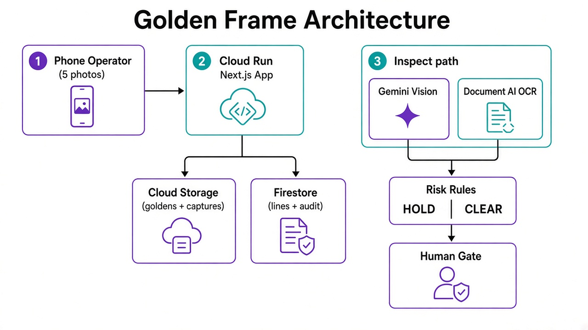
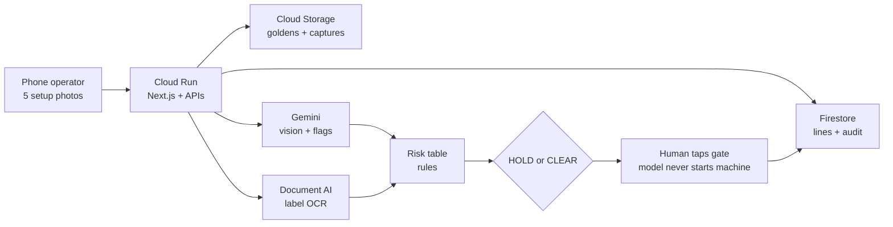

# Golden Frame — Architecture

Phone-first changeover gate on Google Cloud.



## Flow



## Who does what

| Layer | Component | Role |
|---|---|---|
| Client | Phone (PWA / browser) | Capture 5 frames, show HOLD/CLEAR, human logs gate |
| App | Cloud Run (Next.js) | UI + `/api/inspect`, goldens, captures, lines, audit, media |
| Evidence | Cloud Storage | Golden album + today’s captures (`/api/media` private serve) |
| State | Firestore | Lines, golden metadata, shift audit |
| Vision | Gemini (`gemini-3.8-flash`) | Look-alike vs golden, visual flags |
| OCR | Document AI | Printed SKU on **label** frame only (Gemini text fallback) |
| Decision | Risk table (`rules.ts` / `gate.ts`) | must-fix / warn / retake → HOLD or CLEAR |
| Control | Human | Final gate tap — model never starts equipment |

## Inspect path (one check)

1. Upload today’s photos → Cloud Storage  
2. Load golden frames for the line  
3. Gemini compares golden vs today (all slots)  
4. Document AI OCR on label → `extractedText` when available  
5. Rules decide HOLD / CLEAR  
6. Operator/supervisor logs gate → Firestore audit  

## ASCII (for decks / slides)

```text
┌────────────┐     ┌─────────────────────────┐
│   Phone    │────▶│  Cloud Run (Next.js)    │
│ 5 photos   │     └───────────┬─────────────┘
└────────────┘                 │
              ┌────────────────┼────────────────┐
              ▼                ▼                ▼
       Cloud Storage      Firestore         Inspect
       goldens/captures   lines + audit        │
                                      ┌────────┴────────┐
                                      ▼                 ▼
                                   Gemini          Document AI
                                   vision            label OCR
                                      └────────┬────────┘
                                               ▼
                                         Risk table
                                          HOLD/CLEAR
                                               ▼
                                         Human gate
```
